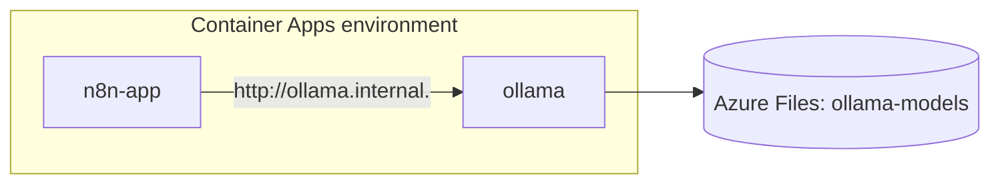

# Ollama for n8n

A separate Container App running [Ollama](https://ollama.com), deployed into the **same resource
group and Container Apps environment** as `n8n-app`. n8n talks to it over the environment's private
network; the app has no public endpoint.



## Deploy

```bash
az login
fxr/infra/ollama/deploy.sh
```

Or run the **FXR: Deploy Ollama** workflow from the Actions tab. Re-running updates the app in
place. Knobs are environment variables on the script (defaults in brackets):

| Variable           | Default            | Notes                                                           |
| ------------------ | ------------------ | --------------------------------------------------------------- |
| `MODELS`           | `llama3.2:3b`      | Space separated. Pulled on start if not already on the share.   |
| `CPU` / `MEMORY`   | `4` / `8Gi`        | Consumption profile ceiling. Larger needs a dedicated profile.  |
| `WORKLOAD_PROFILE` | `Consumption`      | Name of a profile already added to the environment (e.g. GPU).  |
| `IMAGE`            | `ollama/ollama:latest` | Pin a tag once a version is known good.                     |
| `SHARE_QUOTA_GIB`  | `100`              | Model storage. A 7B model is ~4-5 GiB, 3B is ~2 GiB.            |

## Use from n8n

1. Credentials → New → **Ollama**.
2. Base URL: `http://ollama.internal.<environment default domain>` (printed by the script).
   API key stays empty.
3. In an Ollama Chat Model node pick one of the pulled models.

## Sizing

CPU inference on the Consumption profile is fine for 1B-3B models and light workloads. For 7B+
models or real throughput, add a GPU workload profile to the environment and pass its name as
`WORKLOAD_PROFILE`, raising `CPU`/`MEMORY` to the profile's size:

```bash
az containerapp env workload-profile add -g n8n-rg -n <env> \
  --workload-profile-name gpu --workload-profile-type Consumption-GPU-NC8as-T4
WORKLOAD_PROFILE=gpu CPU=8 MEMORY=56Gi MODELS="llama3.1:8b" fxr/infra/ollama/deploy.sh
```

GPU profiles are region dependent; the environment must be the workload-profiles type (a
non-empty `properties.workloadProfiles` on `az containerapp env show`).

## Operations

```bash
az containerapp logs show -g n8n-rg -n ollama --follow      # pull progress, requests
az containerapp exec -g n8n-rg -n ollama --command "ollama list"
az containerapp exec -g n8n-rg -n ollama --command "ollama pull mistral:7b"
```

Models pulled by hand also land on the share. Add them to `MODELS` so a fresh replica pulls them
if the share is ever recreated.

## Notes

- Ollama has no authentication. Internal-only ingress is the access control; do not flip
  `external` to true without putting an authenticating proxy in front.
- Scales to zero after a few idle minutes and bills nothing until the next request. The first
  request after idle cold-starts the replica and reloads the model from the share (1 to 3 minutes
  on a GPU profile), so the first chat message after a quiet spell may time out. For always-on,
  run `az containerapp update -g n8n-rg -n ollama --min-replicas 1`.
- Azure Files is SMB: first load of a model after a restart is slower than local disk. With
  `OLLAMA_KEEP_ALIVE=-1` it stays in memory afterwards.
