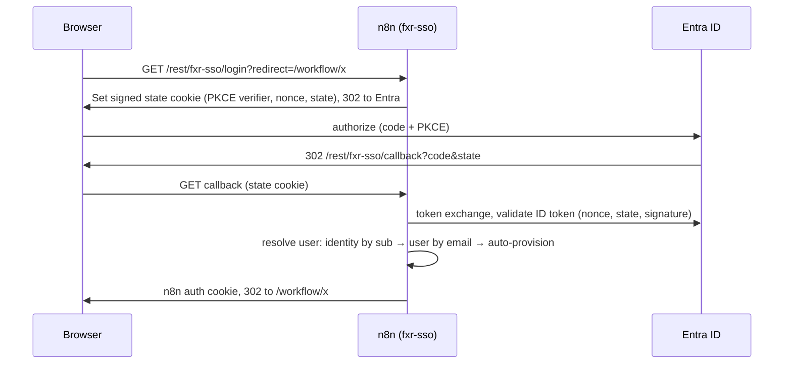

# Spec: `fxr-sso`, Microsoft sign-in for n8n

Status: built, awaiting Entra app registration and first live test.

## Goal

Team members sign in to n8n with their FXR Microsoft account. First sign-in creates their n8n
user automatically. Email/password stays available for the owner as a break-glass path.
n8n's own OIDC/SAML/LDAP are Enterprise-gated `.ee` modules; `fxr-sso` is an FXR module built
only from free code.

## Flow

## Building blocks (all free)

| Need | Used |
|---|---|
| OIDC client | `openid-client` 6.5, already a CLI dependency |
| Signed state | `JwtService.sign/verify`, 10 minute TTL, httpOnly cookie |
| Session | `AuthService.issueCookie`, same cookie password login issues |
| User creation | `UserRepository.createUserWithProject` (user + personal project + owner relation) |
| Identity link | `AuthIdentity` with `providerType: 'oidc'`, `providerId: sub`. Marks the user non-pending |
| Sign-in button | existing `SSOLogin.vue`, shown when public settings carry `sso.fxr.loginEnabled` |

## Configuration

Two sources, in priority order:

1. **Environment variables** (`FXR_SSO_*`, see module README). When `FXR_SSO_ISSUER` is set the
   settings page is read-only. A `configure-sso.sh` helper applies them to the container app.
2. **Settings → Single Sign-On** in the UI (owner only). The module replaces the Enterprise upsell
   with an FXR panel: enable toggle, issuer, client ID, client secret (stored encrypted with the
   instance key in n8n's `settings` table, never returned to the browser), allowed email domains,
   auto-provision, default role, button label, the redirect URI to paste into Entra, a **Test
   connection** button that runs OIDC discovery, and **Save**. Saving refreshes the module settings
   so the sign-in button appears without a restart.

API: `GET/PUT /rest/fxr-sso/config`, `POST /rest/fxr-sso/config/test`, scope `saml:manage`.
The module is enabled through the pipeline's module list (already added).

## Entra ID app registration (one-time, by a tenant admin)

1. Entra admin center → App registrations → New: name "FXR n8n", single tenant.
2. Redirect URI (Web): `https://<n8n host>/rest/fxr-sso/callback`.
3. Certificates & secrets → New client secret. Copy the value.
4. API permissions: `openid`, `profile`, `email` (delegated, default). Grant admin consent.
5. Optional: Enterprise application → Properties → "Assignment required" = Yes, and assign the
   groups who may use n8n. Combined with `FXR_SSO_ALLOWED_DOMAINS` this is the access boundary.
6. Collect: Directory (tenant) ID, Application (client) ID, secret.

## Security notes

- PKCE + nonce + state, all verified. State is a server-signed JWT, so it cannot be forged.
- Redirect targets go through n8n's `validateRedirectUrl`, local paths only.
- Email domain allow-list is enforced before any database access.
- Disabled n8n users cannot sign in via SSO. Deleting a user in n8n also ends SSO access; removing
  them from the Entra assignment stops it at the provider.
- Provisioned users get the `global:member` role and a placeholder, unusable password.
- MFA: enforced at Entra, so n8n's own MFA is left off for SSO users.

## Verification plan

1. Deploy, run `configure-sso.sh`, confirm the sign-in page shows "Continue with SSO (Microsoft)".
2. Sign in as the owner's Microsoft account: expect link to existing owner user, no new user.
3. Sign in as a colleague not yet in n8n: expect a new member user and personal project.
4. Sign in with a non-FXR Microsoft account: expect redirect to `/signin?ssoError=sso_failed`.
5. Disable a user in n8n, retry: refused.

## Out of scope

SAML, LDAP, group-to-role mapping (follow-up: map Entra groups to `global:admin` or project roles
via a claim), SCIM provisioning, forcing SSO-only login.
