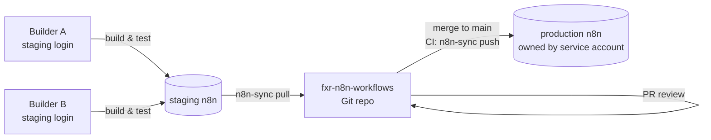

# Spec: team collaboration on n8n without Enterprise sharing

Status: draft for review. Owner: Derek. Target: production n8n on Azure (`n8n-app`), staging to follow.

## Problem

n8n Community gives every user a personal space and no way to share workflows or credentials with
other users. n8n's own sharing UI and team projects are Enterprise features (see
`LICENSED-FEATURES.md`). We have several people who need to build, review and operate the same
workflows. This spec solves it in two layers, both inside the Sustainable Use License's "internal
business purposes" grant and without modifying or deriving from any `.ee` file:

1. **`fxr-sharing` module** (built, `packages/cli/src/modules/fxr-sharing/`): an FXR-authored
   backend module that writes `workflow:editor` / `credential:user` rows into the free
   `shared_workflow` and `shared_credentials` tables. n8n's list, open, run and update paths are
   role-driven and license-free, so sharees see and edit shared items in the normal UI. Enabled per
   environment with `N8N_ENABLED_MODULES=fxr-sharing`, set by the deploy pipeline.
2. **Git as the system of record** for promotion between staging and production (below).

## Layer 1: `fxr-sharing`

| Method | Path | Who may call |
|---|---|---|
| GET | `/rest/fxr-sharing/users` | any member, lists active users |
| GET / PUT | `/rest/fxr-sharing/workflows/:id` | workflow owner or instance owner |
| GET / PUT | `/rest/fxr-sharing/credentials/:id` | credential owner or instance owner |

PUT takes `{ userIds: string[] }` and replaces the sharee list. Sharees get `workflow:editor`
(open, edit, run, activate) or `credential:user` (use in a workflow, not view secrets). The owner
keeps ownership; there is no transfer. Unit tests cover add/remove diffing, owner-only enforcement,
instance-owner override, unknown users and self-sharing.

**Still to build:** a small share panel in the editor. n8n's own `WorkflowShareModal.ee.vue` is
Enterprise-licensed and stays untouched; ours is a new component under `features/fxr/` with a user
multi-select calling the endpoints above. Until it exists, sharing is done with a REST call.

## Layer 2: Git promotion

### Facts the design relies on

- The instance owner has global `workflow:read`, `workflow:list` and the credential equivalents
  (`global-scopes.ee.ts`, applied in `workflow-sharing.service.ts`). An owner sees and can run
  everything on the instance regardless of who created it. Members see only their own.
- The public API (owner API key) can list, get, create, update, activate, deactivate, archive and
  tag workflows, and create credentials. It is free and unlimited.
- Workflow JSON references credentials by `id` and `name`. Credential secrets are never exported.
- Unlimited users and active workflows on Community.

## Design

Git becomes the shared workspace. n8n instances are deployment targets, not the place where
collaboration happens.



### 1. Accounts

| Instance | Account | Who | Purpose |
|---|---|---|---|
| production | `automation@fxrracing.com` (owner) | nobody interactively | Owns all prod workflows and credentials. API key used by CI. Password + MFA in the team password manager, break-glass only. |
| production | personal member logins | ops leads | Read nothing by default. Kept only so execution alerts can be assigned. Optional. |
| staging | `automation@fxrracing.com` (owner) | CI | API key for `pull`. |
| staging | personal member logins | every builder | Build and test. Each builder's personal space is their sandbox. |

Nobody edits production in the UI. If someone must, they use the owner account and the change is
pulled back into Git immediately (see Drift below).

### 2. Repository `fxr-n8n-workflows`

```
workflows/
  shopify/order-sync.json
  netsuite/inventory-push.json
manifest.yml            # per-workflow: active, tags, owner team, credentials by name
credentials.yml         # credential NAMES and TYPES only, no secrets
tools/n8n-sync/         # CLI, Node + TypeScript
.github/workflows/
  validate.yml          # on PR
  deploy-prod.yml       # on merge to main
```

Workflow JSON is normalised on `pull`: `id`, `versionId`, `createdAt`, `updatedAt`, node positions
rounded, keys sorted. Credential references are rewritten from `{id, name}` to `{name}` so the same
file imports into any instance. Diffs stay reviewable.

### 3. `n8n-sync` CLI

| Command | Behaviour |
|---|---|
| `pull --from staging [--user me]` | Export workflows from the instance via the public API, normalise, write to `workflows/`. `--user` limits to the caller's personal space on staging so builders only pull their own work. |
| `push --to prod --dry-run` | Resolve credential names to ids on the target, upsert each workflow by name (create if missing, update if changed), set `active` from the manifest, apply tags. Prints the plan. |
| `push --to prod` | Same, for real. Deactivates before update and reactivates after so triggers re-register cleanly. |
| `diff --to prod` | Normalised diff between Git and the target. Non-zero exit on drift. |
| `credentials check --to prod` | Every credential name in `credentials.yml` exists on the target with the right type. Fails the deploy otherwise. |

Config via env: `N8N_SYNC_<ENV>_URL`, `N8N_SYNC_<ENV>_API_KEY`. Keys live in GitHub environment
secrets and in builders' local `.env`, never in the repo.

### 4. Credentials

Secrets are created once per environment by an ops lead, logged in as the owner, with the exact
name from `credentials.yml`. `push` never creates or updates secret values. A workflow referencing a
credential name that does not exist on the target is a hard deploy failure, not a silent broken
node. Staging and production have distinct credentials, for example `Shopify (staging)` vs
`Shopify (prod)`; `manifest.yml` maps a workflow's credential names per environment.

### 5. Flow for a builder

1. Build and test in staging under your own login.
2. `n8n-sync pull --from staging --user me`, commit, open a PR.
3. `validate.yml` runs: JSON schema check, `credentials check --to prod`, `push --to prod --dry-run`
   posted as a PR comment.
4. Reviewer approves. Merge to `main`.
5. `deploy-prod.yml` runs `push --to prod` and waits for each updated workflow to report active.

### 6. Drift

A nightly `diff --to prod` opens a GitHub issue if production differs from `main`. Anyone who made
an emergency change in the UI resolves it by running `pull --from prod` and opening a PR.

### 7. Visibility for non-builders

Execution history lives in production under the owner account. Rather than hand out that login,
`deploy-prod.yml` publishes a summary, and a small scheduled workflow in prod posts failed
executions to a Teams channel. This replaces the Enterprise insights view for our purposes.

## Acceptance criteria

- Two builders can work on different workflows in staging and land both in production the same day
  without touching each other's work or sharing a login.
- A production workflow can be rebuilt from Git alone onto a fresh instance, with only credentials
  entered by hand.
- `diff --to prod` is clean after every deploy.
- No person holds the production owner password day to day. MFA is on. Break-glass use is logged
  in the password manager.

## Rollout

| Phase | Scope | Est. effort |
|---|---|---|
| 1 | Owner service account on prod, API key, repo skeleton, `pull` and `push --dry-run` | 2 days |
| 2 | `push`, credential mapping, `validate.yml`, `deploy-prod.yml` | 3 days |
| 3 | Staging instance, per-builder logins, `--user me`, drift check | 2 days |
| 4 | Teams failure alerts, docs for builders | 1 day |

## Risks and limits

- Builders cannot see each other's staging work in the UI. Git is the only shared view. Acceptable
  for the team size; revisit if pairing in the editor becomes common.
- Manual production edits bypass review until the nightly drift check. Mitigated by the break-glass
  policy.
- Workflows referencing other workflows by `id` (Execute Workflow node) need name-based mapping in
  `push`. Handled in phase 2; until then, use the "from list" mode which stores the name too.
- If the team outgrows this, n8n's Business plan adds sharing, projects and Git-backed source
  control natively, and this repo layout maps directly onto its source control feature.

## Out of scope

Modifying or re-implementing any `.ee` feature. Per-user permissions inside production. Workflow
history beyond what Git provides.

## Open questions

1. Service account mailbox: real shared mailbox or alias on an ops lead's account?
2. Does anyone need to run manual executions in production, or is staging always sufficient?
3. One workflows repo or one folder per business domain inside this fork?
